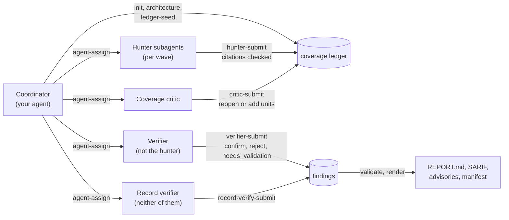

# sec-audit

[](https://github.com/fabriziosalmi/security-audit-cli/actions/workflows/ci.yml)
[](https://github.com/fabriziosalmi/security-audit-cli/actions/workflows/security.yml)
[](https://github.com/fabriziosalmi/security-audit-cli/actions/workflows/slopless.yml)
[](https://scorecard.dev/viewer/?uri=github.com/fabriziosalmi/security-audit-cli)
[](https://github.com/fabriziosalmi/security-audit-cli/releases/latest)
[](go.mod)
[](LICENSE)

**Security audits run by AI agents, where nothing counts until it is checked on disk.**

`sec-audit` is a single Go binary that turns an agent-driven code audit into a state machine with hard gates. Agents propose; the binary decides. A citation to a line that does not exist, a hunter grading its own finding, evidence that is really a symlink to `/etc/passwd`, or a source file edited after review is rejected in code, not by asking a model to be careful. The output is a `REPORT.md`, SARIF for code scanning, GHSA-style advisories, and a `sha256sum -c` manifest over all of it.

It runs as an MCP server for Claude Code, Cursor, Claude Desktop, Codex and other MCP clients, as a CLI, and as a VS Code extension. Standard library only, no dependencies.


## Try it in 30 seconds

```sh
go install github.com/fabriziosalmi/security-audit-cli/cmd/sec-audit@latest   # or a release binary, see Install
sec-audit demo
```

`demo` audits a small Go API bundled in the binary, with scripted agents instead of a model: 22 steps, two confirmed findings, one false positive rejected by an independent verifier, four bad submissions blocked. It takes about a third of a second (median 351 ms over 5 runs on an Apple M4) and leaves everything on disk, so you can open `REPORT.md` and run `shasum -a 256 -c manifest.sha256` yourself. If any gate lets a bad submission through, `demo` exits non-zero.

## Audit your own repository

```sh
sec-audit setup claude      # or: cursor, claude-desktop, print
```

Then, in a new Claude Code session:

```text
/mcp__sec-audit__audit /absolute/path/to/repo
```

or just ask "audit this repository with sec-audit". The server sends the agent its operating instructions on connect, and the `audit` prompt carries the full procedure: recon, coverage plan, hunting waves, coverage critics, adversarial verification, independent record verification, render. The agent you talk to becomes the coordinator and starts a fresh subagent for every role.

## Why

Asking a model to audit code produces confident prose. In practice it fails in a few predictable ways:

| Failure | What `sec-audit` does instead |
| :--- | :--- |
| Citations to files or lines that do not exist | Every `file:line` in a candidate or record is opened through `os.OpenRoot` and checked against the real line count before it is accepted. |
| The agent that found a bug also confirms it | Roles are separate agents with single-use ids. `verifier != hunter`, `record_verifier != hunter, verifier`, enforced at assignment and again at submission. |
| Silent coverage gaps | Work is a ledger of coverage units derived from entrypoints, trust boundaries and attack-class playbooks. Render refuses while units are planned or in progress, while hunter-reported gaps have not been reviewed by a coverage critic, or before the closing critic pass (`final_clean` for `standard` and `deep`, `post_wave` for `quick`). |
| Report describes code that has changed | Every reviewed source file is pinned by SHA-256. `validate`, `status` and `render` re-hash them and refuse on drift. |
| Evidence files that point elsewhere | Agent scratch output is promoted to evidence through an 11-step descriptor-based copy: no symlinks, no hardlinks, no FIFOs, byte caps, re-`fstat` after read. |
| Ambiguous JSON | Every payload is pre-scanned: duplicate keys at any depth are rejected (`{"verdict":"rejected","verdict":"confirmed"}`), with caps on depth, fields, tokens and size. |
| Different output on every run | Units, findings and prompts are sorted before serialization; the run ends with a SHA-256 manifest of every artifact. |

The audit method and the 11 embedded playbooks (`ATTACK-CLASSES.md` plus 10 domain companions) come from [`cloudflare/security-audit-skill`](https://github.com/cloudflare/security-audit-skill/tree/main/skills/security-audit). `sec-audit` replaces its prompt-only rules with checks in code.

## How a run works



`agent-assign` compiles the exact prompt for each role from the architecture summary, the assigned units and the verbatim playbook blocks, and creates the agent's isolated scratch directory. `status` returns `next_required_actions`, so the coordinator never has to guess what comes next.

## What the demo checks

These are the real gate messages from `sec-audit demo`:

| Bad submission | Gate | Message |
| :--- | :--- | :--- |
| Evidence file is a symlink to `/etc/passwd` | `artifact-promote` | `scratch leaf "poc-output.txt" is not a regular non-symlink file` |
| Trace cites `internal/notes/handler.go:999` | `hunter-submit` | `line 999 out of range (file has 68 lines)` |
| The hunter asks to verify its own finding | `agent-assign` | `agent_id "hunter-wave1-a" was already used in this run` |
| An audited file is edited before render | `status`, `render` | SHA-256 drift on `internal/notes/handler.go`, render refused |

It also shows `render` refusing before the Phase 5 record check, a verifier rejecting a plausible-looking SQL injection because the query uses placeholders, and `--fail-on high` failing the CI gate.

## Install

**Homebrew** (macOS and Linux, builds from the tagged source):

```sh
brew tap fabriziosalmi/sec-audit https://github.com/fabriziosalmi/security-audit-cli
brew install sec-audit
```

**Release binary** (macOS and Linux, amd64 and arm64), with SLSA build provenance:

```sh
gh release download --repo fabriziosalmi/security-audit-cli --pattern "sec-audit-darwin-arm64.tar.gz"
gh attestation verify sec-audit-darwin-arm64.tar.gz --repo fabriziosalmi/security-audit-cli
tar -xzf sec-audit-darwin-arm64.tar.gz
install -m 0755 sec-audit-darwin-arm64 ~/.local/bin/sec-audit
```

**Go** 1.24 or newer:

```sh
go install github.com/fabriziosalmi/security-audit-cli/cmd/sec-audit@latest
```

**From source:** `git clone` this repository and run `make install` (installs to `~/.local/bin`, with an ad-hoc code signature on macOS).

## Connect your agent

`sec-audit setup <client>` writes the configuration for you:

| Client | What `setup` does |
| :--- | :--- |
| `claude` | Runs `claude mcp add --scope user sec-audit -- <binary> mcp` |
| `cursor` | Adds `sec-audit` to `~/.cursor/mcp.json`, keeps every other key, saves the old file as `mcp.json.bak` |
| `claude-desktop` | Same, for `claude_desktop_config.json` (macOS and Linux) |
| `print` | Prints the snippets for these and for Codex, changes nothing |

Add `--print` to any client to see the change without making it. For any other MCP client:

```json
{
  "mcpServers": {
    "sec-audit": { "command": "/absolute/path/to/sec-audit", "args": ["mcp"] }
  }
}
```

## CLI and CI

Every step is a subcommand and the MCP tool `sec_audit_<step>`, generated from one registry, so the two cannot drift. Inputs come from flags, `--input file.json`, or `--json '<object>'` (`--json -` reads stdin).

On a terminal, `init`, `status`, `validate`, `render` and `version` print readable text; everywhere else (pipes, CI, agents, the VS Code extension) they print JSON. `--format json|text` forces either; `NO_COLOR` is honoured.

```sh
sec-audit status   --output-dir ./run                   # progress and next required actions
sec-audit validate --output-dir ./run --fail-on high    # exit 1 if invalid, 2 if the gate fails
sec-audit render   --output-dir ./run --fail-on high
(cd ./run && shasum -a 256 -c manifest.sha256)
```

`findings.sarif` is SARIF 2.1.0 and can be uploaded with `github/codeql-action/upload-sarif`. `--fail-on` accepts `critical`, `high`, `medium`, `low`, `needs_validation` and `any`.

<details>
<summary>All subcommands</summary>

| Phase | Subcommand | Enforced invariants |
| :--- | :--- | :--- |
| 1 | `init` | `output_dir` outside the target (or git-ignored), pre-recon budget reserve (6 for `quick`, 7 for `standard`/`deep`), repo scan for languages, manifests, entrypoints and recommended playbooks, prior-run carryover. |
| 1-2 | `catalog` | Lists the embedded playbooks or returns the verbatim text of a `FILE.md#Heading` block. |
| 1 | `architecture` | Visible prose, at most 1,100 words, written atomically to `architecture.md`. |
| 1 | `ledger-seed` | Derives RFC 3986 + Unicode NFC `coverage_id`s, checks `starting_paths` inside the target, checks block references against the catalog, optional SHA-256 carryover of unchanged clean units. |
| 1-5 | `agent-assign` | Lowercase single-use `agent_id`, budget reserves for critics and verifiers, role separation, isolated `scratch/` and `artifacts/`, compiled role prompt. |
| 2-5 | `artifact-promote` | 11-step race-safe copy from `scratch/` to `artifacts/` (`os.Root`, `O_NOFOLLOW`, `nlink == 1`, double `fstat`, byte caps, UTF-8 only). |
| 2 | `hunter-submit` | `reviewed_paths` exist and cover `starting_paths`, every citation checked on disk, sources pinned by SHA-256, check ownership and promoted artifacts verified, candidate schema validated. |
| 2 | `critic-submit` | Archives reopened units into `attempts[]` with a reason, adds missing units, records `post_wave` and `final_clean`. |
| 3 | `verifier-submit` | `verifier != hunter`, record validated against `report-schema.json`, citations checked on disk, `findings.json` updated. |
| 5 | `record-verify-submit` | `record_verifier` differs from hunter and verifier; a material replacement needs one more fresh record verifier. |
| 5-6 | `validate` | JSON preflight, ledger and findings validators, cross-file consistency, SHA-256 drift, optional `--fail-on` gate. |
| 6 | `render` | Refuses on any validation error, drift, unverified candidate or record, unreviewed hunter gap, open unit, or missing closing critic (`final_clean` for `standard`/`deep`, `post_wave` for `quick`) unless `incomplete_reason` is given; writes the reports, SARIF, advisories and manifest. |
| 1-6 | `status` | Unit counts, open candidates, drift, and `next_required_actions`. |

Meta commands outside the registry: `demo`, `setup`, `mcp`, `version`.

</details>

## Output

| File | Contents |
| :--- | :--- |
| `REPORT.md` | Scope statement, severity table, confirmed findings, needs-validation leads, hardening notes, coverage summary. |
| `FINDINGS-DETAIL.md` | Full trace (`entrypoint -> propagation -> sink`), evidence, preconditions, reproduction, fix. |
| `NEEDS-VALIDATION.md` | Leads that need a deployed environment, with blockers and a validation plan. |
| `findings.sarif` | SARIF 2.1.0 for GitHub code scanning and other tools. |
| `advisories/GHSA-<fingerprint>.md` | One coordinated-disclosure advisory per confirmed finding. Fingerprints with characters outside `[A-Za-z0-9._-]` get `_` in their place plus 8 hex digits of their SHA-256, so an advisory never leaves `advisories/`. |
| `coverage-ledger.json`, `findings.json`, `run-metadata.json`, `architecture.md` | Machine-readable state of the run. |
| `manifest.sha256` | `sha256sum -c` / `shasum -a 256 -c` manifest of all of the above. |

## VS Code, Cursor and Antigravity extension

An optional extension in [`editors/vscode/`](editors/vscode/) shows run status and next actions, findings grouped by verdict with click-through to each trace step and inline diagnostics, the coverage ledger, and the playbook catalog. Install the `.vsix` from the release assets, or build it with `make vsix`.

## Supply chain

Tagged releases ([`release.yml`](.github/workflows/release.yml)) publish `CGO_ENABLED=0` archives for four platforms, the `.vsix`, `SHA256SUMS.txt`, SPDX and CycloneDX SBOMs, keyless Sigstore bundles, and GitHub build provenance and SBOM attestations:

```sh
gh attestation verify sec-audit-darwin-arm64.tar.gz --repo fabriziosalmi/security-audit-cli
cosign verify-blob \
  --certificate-identity-regexp '^https://github.com/fabriziosalmi/security-audit-cli/' \
  --certificate-oidc-issuer https://token.actions.githubusercontent.com \
  --bundle SHA256SUMS.txt.bundle SHA256SUMS.txt
shasum -a 256 -c SHA256SUMS.txt --ignore-missing
```

## Measurements

Apple M4, `darwin/arm64`, measured on 2026-11-16 with `go test -bench=. -benchmem ./internal/validator ./internal/engine`:

| Benchmark | Time | Memory | Allocations |
| :--- | ---: | ---: | ---: |
| `BenchmarkDeriveCoverageID` | 3.4 µs/op | 208 B/op | 1 |
| `BenchmarkValidateCoverageLedger` | 19.2 µs/op (42 MB/s) | 11.4 KB/op | 256 |
| `BenchmarkValidateFindings` | 27.0 µs/op (43 MB/s) | 20.2 KB/op | 477 |
| `BenchmarkEndToEndWorkflow` (full run with coverage critic, `fsync` included) | 121 ms/op (median of 3) | 514 KB/op | 4,196 |
| `sec-audit demo` (22 steps, 5 runs) | median 351 ms | | |

`make test` runs `go vet` and the race detector over every package; `make fuzz` runs the four fuzz targets.

## Repository layout

```text
cmd/sec-audit/        CLI entrypoint, demo and setup commands, text output
editors/vscode/       VS Code extension and a pure-Go VSIX packager
internal/demo/        Embedded demo target and scripted run
internal/engine/      Phase 1-6 state machine and role gates
internal/mcp/         JSON-RPC 2.0 stdio server, instructions, audit prompt
internal/promote/     Race-safe artifact promotion
internal/prompt/      Role prompt compiler
internal/registry/    One registry for CLI subcommands and MCP tools
internal/report/      Markdown, advisory and SARIF builders
internal/scanner/     Repo scanner, git metadata, carryover, drift
internal/spec/        Embedded playbooks and report-schema.json
internal/store/       Run store and atomic writes
internal/validator/   JSON preflight, ledger, findings and path validators
```

## Contributing and security

See [CONTRIBUTING.md](CONTRIBUTING.md). Report vulnerabilities privately as described in [SECURITY.md](SECURITY.md).

## License

[MIT](LICENSE). Copyright (c) 2026 Fabrizio Salmi. The playbooks in `internal/spec/assets/` are adapted from [`cloudflare/security-audit-skill`](https://github.com/cloudflare/security-audit-skill/tree/main/skills/security-audit).
