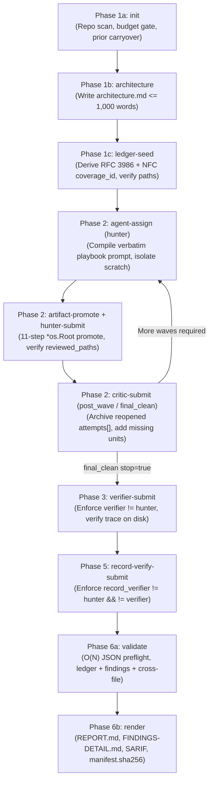

# sec-audit

[](.github/workflows/ci.yml)
[](CHANGELOG.md)
[](go.mod)
[](LICENSE)

`sec-audit` is a deterministic Go CLI and Model Context Protocol (MCP `stdio` JSON-RPC 2.0) server that enforces a 6-phase adversarial security audit state machine over source repositories.

Built on the methodology and embedded domain playbooks of [`cloudflare/security-audit-skill`](https://github.com/cloudflare/security-audit-skill/tree/main/skills/security-audit), `sec-audit` replaces prompt-only instructions with hard programmatic gates: every coverage unit, source citation, local verification check, adversarial role transition, and final report artifact is verified on disk before the state machine advances.

One binary. Go 1.24+ standard library only. Zero external dependencies. Strict 1:1 parity between CLI subcommands and MCP tools via a single generic command registry.

---

## Table of Contents

- [Why sec-audit](#why-sec-audit)
- [6-Phase State Machine](#6-phase-state-machine)
- [1:1 CLI Subcommands and MCP Tools](#11-cli-subcommands-and-mcp-tools)
- [Deterministic Security and Reproducibility Invariants](#deterministic-security-and-reproducibility-invariants)
- [Installation](#installation)
- [MCP Server Configuration](#mcp-server-configuration)
- [End-to-End CLI Walkthrough](#end-to-end-cli-walkthrough)
- [Canonical Output Artifacts](#canonical-output-artifacts)
- [Measured Performance and Benchmarks](#measured-performance-and-benchmarks)
- [Repository Architecture](#repository-architecture)
- [License](#license)

---

## Why sec-audit

Multi-agent security audits degrade when orchestrators rely on unverified LLM prose:

1. **Phantom citations**: Agents cite non-existent files, symlinks escaping the repository, or out-of-range line numbers.
2. **Self-grading bias**: The same agent that proposes a hypothesis also confirms it or rewrites the final report record.
3. **Silent coverage gaps**: Attack-class playbooks or repository entrypoints are silently skipped without explicit exclusion rationale.
4. **Parser differentials**: Duplicate JSON keys (`{"verdict":"rejected","verdict":"confirmed"}`) or deeply nested payloads slip past standard unmarshalers.
5. **Non-reproducible outputs**: Unordered map iteration produces different prompts, ledgers, or reports across runs.

`sec-audit` eliminates these failure modes deterministically in code:

- Every CLI subcommand (`sec-audit <subcommand>`) and MCP tool (`sec_audit_<subcommand>`) is bound through a single generic [`Bind[Req, Resp]`](internal/registry/registry.go) registration, guaranteeing 1:1 schema and execution parity by construction.
- All 11 attack-class catalogs (`ATTACK-CLASSES.md` + 10 domain companions) and `report-schema.json` are embedded in the binary via `//go:embed` ([`internal/spec`](internal/spec/catalog.go)).
- Phase 6 report rendering is blocked until [`Validate`](internal/engine/phase6_render.go) confirms 0 ledger errors, 0 finding errors, 100% cross-file fingerprint linkage, and adversarial role separation (`hunter != verifier != record_verifier`).

---

## 6-Phase State Machine



---

## 1:1 CLI Subcommands and MCP Tools

Every subcommand accepts either CLI flags, `--input <path.json>`, or `--json '<raw-json>'` (use `--json -` to read from `stdin`), and emits deterministic indented JSON on `stdout`.

| Phase | CLI Subcommand | MCP Tool | Enforced Invariants |
| :--- | :--- | :--- | :--- |
| **1** | `sec-audit init` | `sec_audit_init` | Verifies `output_dir` is outside `target` (or git-ignored), enforces pre-recon budget reserve (`>= 6` for `quick`, `>= 7` for `standard`/`deep`), scans repository languages/manifests/companions, and evaluates prior-run carryovers. |
| **1-2** | `sec-audit catalog` | `sec_audit_catalog` | Lists embedded companion playbooks or returns the verbatim Markdown and `When to use` guidance for any canonical `FILE.md#Heading` reference. |
| **1** | `sec-audit architecture` | `sec_audit_architecture` | Validates visible prose and the ~1,000-word limit (`<= 1,100` words hard cap), then atomically writes `<output-dir>/architecture.md`. |
| **1** | `sec-audit ledger-seed` | `sec_audit_ledger_seed` | Derives RFC 3986 + Unicode NFC `coverage_id` values, verifies `starting_paths` inside `target` via `*os.Root`, checks companion block coverage against `selected_companion_files`, sorts units lexicographically, and writes `coverage-ledger.json`. |
| **1-5** | `sec-audit agent-assign` | `sec_audit_agent_assign` | Validates canonical lowercase `agent_id`, enforces budget reserves for remaining critics/verifiers, enforces adversarial role separation, creates `agents/<id>/scratch` and `artifacts`, and compiles the role prompt. |
| **2-5** | `sec-audit artifact-promote` | `sec_audit_artifact_promote` | Executes 11-step OS race-safe promotion from `agents/<id>/scratch` to `agents/<id>/artifacts` using `*os.Root`, `O_NOFOLLOW \| O_NONBLOCK`, `nlink == 1`, double-`Fstat`, and byte caps. |
| **2** | `sec-audit hunter-submit` | `sec_audit_hunter_submit` | Verifies every unit's `reviewed_paths` exist in `target` and cover `starting_paths`, verifies check ownership and promoted artifacts, validates candidate schema, and updates `coverage-ledger.json`. |
| **2** | `sec-audit critic-submit` | `sec_audit_critic_submit` | Archives reopened units into `attempts[]` with `reassignment_reason`, inserts `missing_units`, records `resolved_prior_leads`, and tracks `post_wave` and `final_clean` completion. |
| **3** | `sec-audit verifier-submit` | `sec_audit_verifier_submit` | Enforces `verifier != hunter`, validates final `confirmed`, `needs_validation`, or `rejected` record against `report-schema.json` and on-disk `file:line` citations, and updates `findings.json`. |
| **5** | `sec-audit record-verify-submit` | `sec_audit_record_verify_submit` | Enforces 3-way independence (`record_verifier != hunter` and `record_verifier != verifier`); if a material replacement is submitted, requires another fresh `record_verifier` before Phase 6. |
| **5-6** | `sec-audit validate` | `sec_audit_validate` | Runs single-pass $O(N)$ JSON preflight, `ValidateCoverageLedgerBytes`, `ValidateFindingsBytes`, and `ValidateCrossFileConsistency`. Exits with code `1` if `valid == false`. |
| **6** | `sec-audit render` | `sec_audit_render` | Blocks if any validation, critic, or Phase 5 invariant is unsatisfied; writes `REPORT.md`, `FINDINGS-DETAIL.md`, `NEEDS-VALIDATION.md`, `findings.sarif`, and `manifest.sha256`. |

---

## Deterministic Security and Reproducibility Invariants

### 1. Single-Pass $O(N)$ JSON Preflight (`internal/validator/preflight.go`)
Standard Go `encoding/json.Unmarshal` silently accepts duplicate JSON object keys (last key wins), enabling parser-differential smuggling across tools. [`ValidateJSONPreflight`](internal/validator/preflight.go) scans every JSON payload token-by-token in $O(N)$ before unmarshaling and enforces:
- **Zero duplicate keys** at every object depth.
- **`MaxNestingDepth = 64`** container nesting cap.
- **`MaxObjectFields = 1,000`** keys per object cap.
- **`MaxPreflightValues = 500,000`** total tokens cap and **`MaxInputBytes = 5 MiB`** file size cap.

### 2. Kernel-Enforced `*os.Root` Repository Grounding (`internal/validator/common.go`)
[`VerifyRepoFileAndLine`](internal/validator/common.go) verifies every cited repository path and line number using Go's kernel-backed `os.OpenRoot(targetDir)`:
- Walks every parent segment with `root.Lstat` to reject intermediate symlinks or non-directory components.
- Opens target files with `O_RDONLY | O_NOFOLLOW | O_NONBLOCK`.
- Re-verifies `f.Stat()` on the opened file descriptor (`Mode().IsRegular()` and `Size() <= MaxInputBytes`).
- Bounds line-counting reads via `io.LimitReader(f, MaxInputBytes+1)` so concurrent file growth inside the target workspace cannot cause unbounded memory allocation.

### 3. 11-Step Race-Safe Artifact Promotion (`internal/promote/promote_unix.go`)
[`PromoteAllowlist`](internal/promote/promote_unix.go) promotes local verification outputs from untrusted agent scratch directories without path-based TOCTOU races:
1. Validates canonical relative path syntax and blocks reserved device names.
2. Opens `scratchDir` via `os.OpenRoot`.
3. Verifies every parent directory segment via `root.Lstat`.
4. Inspects target metadata via `root.Lstat` (rejecting symlinks, FIFOs, sockets, devices).
5. Opens descriptor with `O_RDONLY | O_NOFOLLOW | O_NONBLOCK`.
6. Verifies `syscall.Fstat` on the opened descriptor (`S_IFREG`, `nlink == 1` to block hardlinks, size `<= maxFileBytes`).
7. Reads in bounded chunks while enforcing both per-file (`1 MiB` default) and cumulative (`10 MiB` default) byte caps.
8. Re-runs `syscall.Fstat` after reading and verifies `(Dev, Ino, Mode, Nlink, Size, ModTime)` did not mutate during read.
9. Rejects non-UTF-8 or binary content containing NUL bytes.
10. Walks destination parents via `artifactsRoot`, creates missing directories (`0700`), exclusively opens the destination leaf (`O_WRONLY | O_CREAT | O_EXCL | O_NOFOLLOW`, `0600`), verifies `fstat` (`S_IFREG`, `nlink == 1`), writes, and calls `Sync()`.
11. Returns the canonical run-relative artifact path (`agents/<agent-id>/artifacts/<rel>`).

### 4. Bit-for-Bit Reproducibility and `manifest.sha256` (`internal/store`, `internal/engine`)
All map keys, coverage units (`coverage_id`), findings (`fingerprint`), and candidate prompts are sorted lexicographically prior to serialization. Phase 6 `render` emits a cryptographic `manifest.sha256` covering all 8 canonical run artifacts, verifiable with `shasum -a 256 -c manifest.sha256`.

---

## Installation

### From Source

Requires Go `1.24` or newer.

```sh
git clone https://github.com/fabriziosalmi/security-audit-cli.git
cd security-audit-cli
make install
```

`make install` compiles `sec-audit` with `-trimpath -ldflags="-s -w"`, removes any pre-existing binary at `~/.local/bin/sec-audit` before installing (preventing macOS `amfid` vnode cache `SIGKILL 137`), and applies an ad-hoc code signature on macOS.

### Supply Chain Verification (SLSA Provenance, Cosign Keyless, SBOM)

Every tagged GitHub release ([`.github/workflows/release.yml`](.github/workflows/release.yml)) publishes `CGO_ENABLED=0` reproducible POSIX archives (`linux-amd64`, `linux-arm64`, `darwin-amd64`, `darwin-arm64`), `SHA256SUMS.txt`, dual SBOMs (`sec-audit.sbom.spdx.json` and `sec-audit.sbom.cdx.json`), keyless Sigstore Cosign OIDC bundles (`.bundle`), and GitHub SLSA Build Provenance + SBOM attestations:

```sh
# 1. Verify SLSA Build Provenance and SBOM attestations via GitHub CLI
gh attestation verify sec-audit-darwin-arm64.tar.gz --repo fabriziosalmi/security-audit-cli

# 2. Verify SHA256SUMS.txt and SBOMs via Sigstore Cosign keyless OIDC bundle
cosign verify-blob \
  --certificate-identity-regexp '^https://github.com/fabriziosalmi/security-audit-cli/' \
  --certificate-oidc-issuer https://token.actions.githubusercontent.com \
  --bundle SHA256SUMS.txt.bundle \
  SHA256SUMS.txt

shasum -a 256 -c SHA256SUMS.txt --ignore-missing
```

---

## MCP Server Configuration

Run `sec-audit mcp` to start the JSON-RPC 2.0 server over `stdio`.

### Claude Code

```sh
claude mcp add sec-audit ~/.local/bin/sec-audit mcp
```

### Claude Desktop / Cursor / Antigravity (`mcp_config.json`)

```json
{
  "mcpServers": {
    "sec-audit": {
      "command": "/Users/your-user/.local/bin/sec-audit",
      "args": ["mcp"]
    }
  }
}
```

---

## End-to-End CLI Walkthrough

```sh
# 1. Initialize an audit run outside the target repository
sec-audit init \
  --target /path/to/repo \
  --output-dir /tmp/audit-run-1 \
  --profile standard

# 2. Inspect embedded attack-class catalogs
sec-audit catalog
sec-audit catalog --block "ATTACK-CLASSES.md#Resource and file handling"

# 3. Write Phase 1b architecture summary (<= 1,000 words)
sec-audit architecture \
  --output-dir /tmp/audit-run-1 \
  --file /tmp/architecture.md

# 4. Seed the deterministic coverage ledger
sec-audit ledger-seed \
  --output-dir /tmp/audit-run-1 \
  --input /tmp/seed-units.json

# 5. Assign a Phase 2 hunter and compile its verbatim playbook prompt
sec-audit agent-assign \
  --output-dir /tmp/audit-run-1 \
  --role hunter \
  --agent-id hunter-wave1-a \
  --coverage-ids "<coverage-id-1>,<coverage-id-2>"

# 6. Promote local check evidence and submit hunter results
sec-audit artifact-promote \
  --output-dir /tmp/audit-run-1 \
  --agent-id hunter-wave1-a \
  --files "check_output.txt"

sec-audit hunter-submit --input /tmp/hunter-wave1-a-result.json

# 7. Run post-wave and final-clean coverage critics
sec-audit agent-assign --output-dir /tmp/audit-run-1 --role critic --agent-id critic-wave1
sec-audit critic-submit --input /tmp/critic-wave1.json

sec-audit agent-assign --output-dir /tmp/audit-run-1 --role critic --agent-id critic-final
sec-audit critic-submit --critic-kind final_clean --input /tmp/critic-final.json

# 8. Verify candidate findings with a fresh Phase 3 verifier (verifier != hunter)
sec-audit agent-assign \
  --output-dir /tmp/audit-run-1 \
  --role verifier \
  --agent-id verifier-find-0001 \
  --fingerprint FIND-0001

sec-audit verifier-submit --input /tmp/verifier-find-0001.json

# 9. Verify confirmed finding records with a fresh Phase 5 record_verifier
sec-audit agent-assign \
  --output-dir /tmp/audit-run-1 \
  --role record_verifier \
  --agent-id rec-verifier-find-0001 \
  --fingerprint FIND-0001

sec-audit record-verify-submit --input /tmp/rec-verifier-find-0001.json

# 10. Validate and render final reports + SHA-256 manifest
sec-audit validate --output-dir /tmp/audit-run-1
sec-audit render --output-dir /tmp/audit-run-1
(cd /tmp/audit-run-1 && shasum -a 256 -c manifest.sha256)
```

---

## Canonical Output Artifacts

Every completed audit run in `<output-dir>` produces 8 canonical files verified by `manifest.sha256`:

| File | Purpose |
| :--- | :--- |
| `run-metadata.json` | Run configuration, git `source_ref`, `dirty_worktree` flag, `profile`, `agents_spent`, `selected_companion_files`, and terminal `run_status`. |
| `architecture.md` | Phase 1b trust boundaries, entrypoints, privileged sinks, and subsystem map (`<= 1,000` words). |
| `coverage-ledger.json` | Canonical sorted array of coverage units, `local_checks`, `reviewed_paths`, `attempts[]`, and `result_fingerprints`. |
| `findings.json` | Canonical sorted array of verified `confirmed`, `needs_validation`, and `rejected` records conforming to `report-schema.json`. |
| `REPORT.md` | Executive and technical summary with scope statement, severity table, confirmed findings, blocked leads, hardening notes, and coverage summary. |
| `FINDINGS-DETAIL.md` | Full source trace (`entrypoint -> propagation* -> sink`), evidence citations, preconditions, reproduction instructions, and code fixes. |
| `NEEDS-VALIDATION.md` | Unresolved leads requiring external environment or deployment validation, including validation plans and blockers. |
| `findings.sarif` | SARIF 2.1.0 report mapping confirmed findings and source locations for GitHub Code Scanning and static analysis pipelines. |
| `manifest.sha256` | Standard `sha256sum -c` / `shasum -a 256 -c` manifest of all 8 canonical artifacts above. |

---

## Measured Performance and Benchmarks

Measured on Apple M4 (`darwin/arm64`, Go `1.24+`) via `make bench` and `make fuzz`:

| Benchmark / Suite | Latency / Throughput | Memory (`B/op`) | Allocations (`allocs/op`) |
| :--- | :--- | :--- | :--- |
| [`BenchmarkDeriveCoverageID`](internal/validator/benchmark_test.go) | `3,041 ns/op` | `208 B/op` | `1 alloc/op` |
| [`BenchmarkValidateCoverageLedger`](internal/validator/benchmark_test.go) | `19,951 ns/op` (`40.65 MB/s`) | `11,510 B/op` | `256 allocs/op` |
| [`BenchmarkValidateFindings`](internal/validator/benchmark_test.go) | `26,282 ns/op` (`44.29 MB/s`) | `20,234 B/op` | `477 allocs/op` |
| [`BenchmarkEndToEndWorkflow`](internal/engine/reproducibility_test.go) (full 6-phase run + 10 APFS `fsync` calls) | `80.9 ms/op` | `322,890 B/op` | `1,616 allocs/op` |
| [`FuzzValidateFindingsBytes`](internal/validator/benchmark_test.go) | `147,798 execs/sec` (`598,631` execs / 5s) | `n/a` | `0 crashes / 0 panics` |

---

## Repository Architecture

```text
security-audit-cli/
├── cmd/sec-audit/          # CLI entrypoint and flag-to-JSON normalizer (89.8% coverage)
└── internal/
    ├── engine/             # Phase 1-6 state machine and role gates (79.4% coverage)
    ├── mcp/                # JSON-RPC 2.0 stdio server (90.6% coverage)
    ├── promote/            # 11-step *os.Root race-safe artifact promotion (81.5% coverage)
    ├── prompt/             # Deterministic role prompt compiler (97.5% coverage)
    ├── registry/           # Generic Bind[Req, Resp] 1:1 CLI/MCP registry (92.5% coverage)
    ├── report/             # Deterministic Markdown and SARIF 2.1.0 builders (92.2% coverage)
    ├── scanner/            # Table-driven repo scanner and git/carryover inspector (89.4% coverage)
    ├── spec/               # Embedded playbooks and report-schema.json (94.2% coverage)
    ├── store/              # RunStore and crash-safe WriteFileAtomic (81.4% coverage)
    └── validator/          # O(N) JSON preflight, ledger/findings/root validators (84.0% coverage)
```

---

## License

Released under the [MIT License](LICENSE). Copyright (c) 2026 Fabrizio Salmi.
Embedded security audit playbooks in `internal/spec/assets/` are adapted from [`cloudflare/security-audit-skill`](https://github.com/cloudflare/security-audit-skill/tree/main/skills/security-audit).
